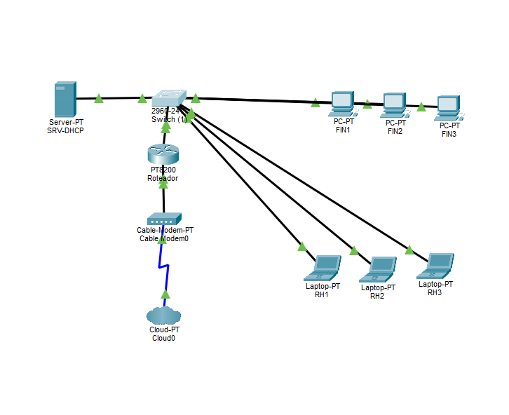

# 🌐 Lab Alfa 1.0 — Segmentação de Rede Corporativa (Cisco Packet Tracer)

Projeto prático de infraestrutura de redes focado em **isolamento de tráfego (VLANs)**, **roteamento Inter-VLAN (Router-on-a-Stick)** e **centralização de DHCP via Relay (`ip helper-address`)**.

---

## 🗺️ Topologia da Rede

---

## 📋 Endereçamento e VLANs

| VLAN ID | Setor / Função | Sub-rede | Default Gateway (Subinterface) | Portas no Switch (2960) |
| :--- | :--- | :--- | :--- | :--- |
| **VLAN 10** | Financeiro (FIN) | `192.168.10.0/24` | `192.168.10.1` (`Gi0/0/1.10`) | `Fa0/1` a `Fa0/3` |
| **VLAN 11** | Recursos Humanos (RH) | `192.168.11.0/24` | `192.168.11.1` (`Gi0/0/1.11`) | `Fa0/4` a `Fa0/6` |
| **VLAN 20** | Servidores (`srv-dhcp`) | `192.168.20.0/24` | `192.168.20.1` (`Gi0/0/1.20`) | `Fa0/23` |
| **Trunk** | Uplink Switch ↔ Router | 802.1Q (`dot1Q`) | — | `Fa0/24` ↔ `Gi0/0/1` |

---

## ⚙️ Tecnologias Implementadas (v1.0)

* **Camada 2 (Switch 2960):** Criação de VLANs para separação de domínios de broadcast e configuração de porta **Trunk (IEEE 802.1Q)** no uplink para o roteador.
* **Camada 3 (Router PT8200):** Arquitetura **Router-on-a-Stick** utilizando subinterfaces lógicas (`Gi0/0/1.10`, `.11` e `.20`) com encapsulamento `dot1Q`.
* **Serviços (DHCP Relay):** Servidor DHCP/DNS isolado na VLAN 20 (`192.168.20.254`) distribuindo IPs automaticamente para as VLANs 10 e 11 através do comando `ip helper-address` nas subinterfaces do roteador.

---

## 🚀 Roadmap (Próximas Atualizações)
- [ ] Validação completa de DHCP Relay e DNS interno
- [ ] Implementação de ACLs estendidas entre setores (bloqueio de tráfego não autorizado)
- [ ] Hardening de Switch (`port-security`, shutdown em portas não utilizadas e filtro de VLANs no Trunk)
- [ ] Configuração de NAT para saída de Internet
